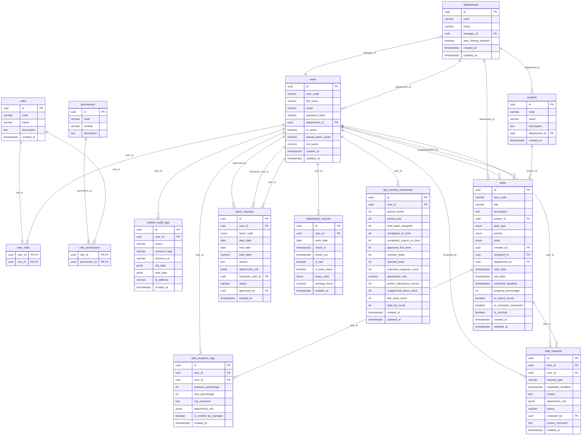
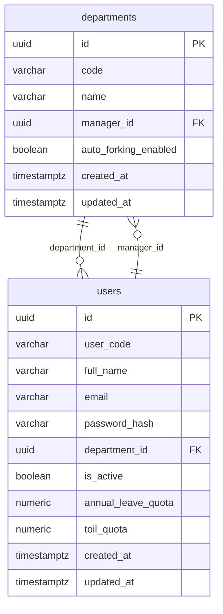
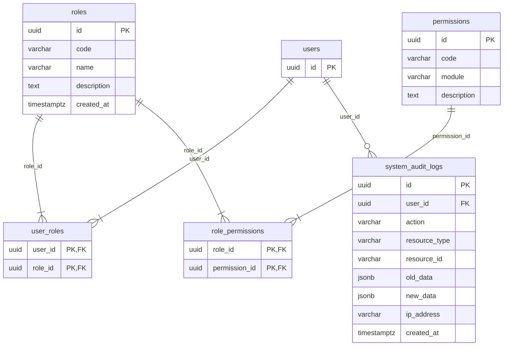
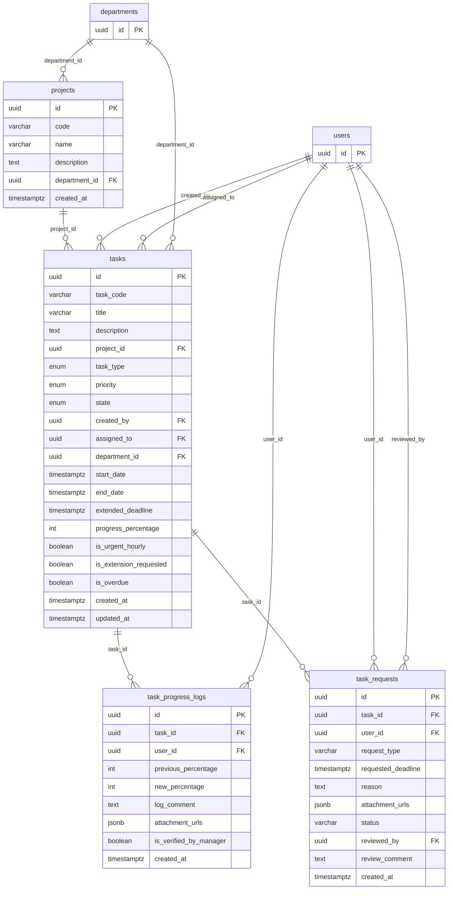
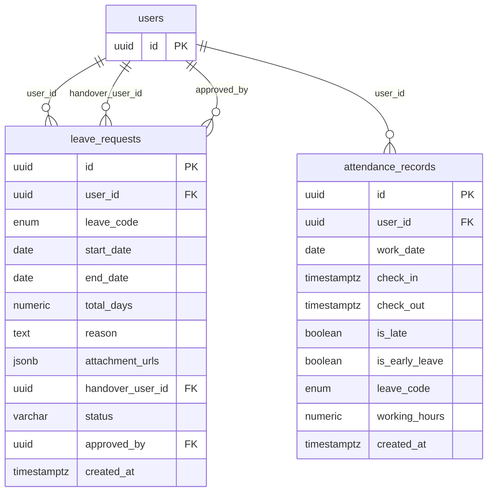
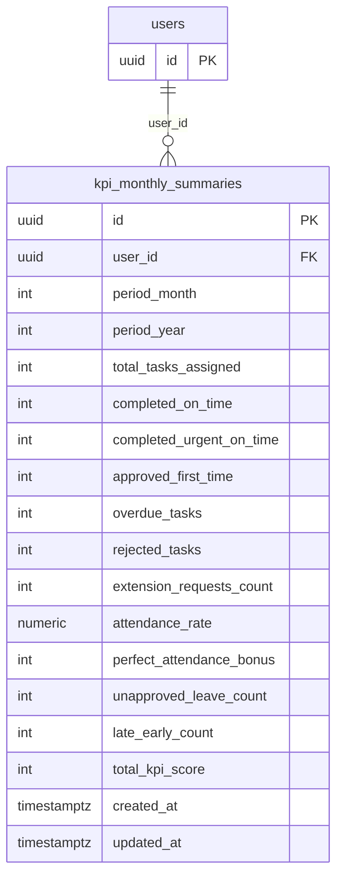

# DATABASE_SCHEMA_EXAMPLE_DIAGRAM.md

> ER-diagram view of [`DATABASE_SCHEMA_EXAMPLE.sql`](./DATABASE_SCHEMA_EXAMPLE.sql). Every diagram is **Mermaid `erDiagram`** and renders in Markdown viewers (e.g. GitHub).
>
> **Legend.** Each entity is a table; each attribute is a column with a single-token type (the first word of the SQL type). `PK` marks a primary key, `FK` a foreign key. Composite keys mark each key column `PK`. Relationship lines read `PARENT ||--o{ CHILD : "fk_column"`: `||` = exactly one parent, `o{` = zero-or-many children, `|{` = one-or-many children (a `NOT NULL` foreign key). Each diagram carries a `*Source:*` line naming the SQL it derives from. Names match the DDL exactly.

**Diagram index**

1. [Full ER Diagram](#1-full-er-diagram)
2. [Organization & Identity](#2-organization--identity)
3. [RBAC & Audit](#3-rbac--audit)
4. [Jobs & Projects](#4-jobs--projects)
5. [Planning & Attendance](#5-planning--attendance)
6. [Performance](#6-performance)

---

## 1. Full ER Diagram

All 14 tables of the original schema.

*Source:* `DATABASE_SCHEMA_EXAMPLE.sql` — all sections (enums, Settings & IAM, Jobs & Projects, Planning & Attendance, Performance & Audit).

---

## 2. Organization & Identity

`departments` and `users`, with the manager ↔ department relationships.

*Source:* `DATABASE_SCHEMA_EXAMPLE.sql` — section 2 (Settings & IAM: departments, users).

---

## 3. RBAC & Audit

Roles, permissions, their join tables, and the system audit log.

*Source:* `DATABASE_SCHEMA_EXAMPLE.sql` — section 2 (Settings & IAM: RBAC roles, permissions, audit logs).

---

## 4. Jobs & Projects

Projects, tickets, progress logs, and extension/late-submission requests.

*Source:* `DATABASE_SCHEMA_EXAMPLE.sql` — section 3 (Jobs & Projects). Cross-domain parents (`users`, `departments`) are shown as key-only entities.

---

## 5. Planning & Attendance

Leave requests and daily attendance records.

*Source:* `DATABASE_SCHEMA_EXAMPLE.sql` — section 4 (Planning & Attendance). `users` is shown as a key-only cross-domain entity.

---

## 6. Performance

The per-user, per-month KPI summary.

*Source:* `DATABASE_SCHEMA_EXAMPLE.sql` — section 5 (Performance & Audit). `users` is shown as a key-only cross-domain entity.

---

*This document is a visual summary only; `DATABASE_SCHEMA_EXAMPLE.sql` is authoritative for detail.*
