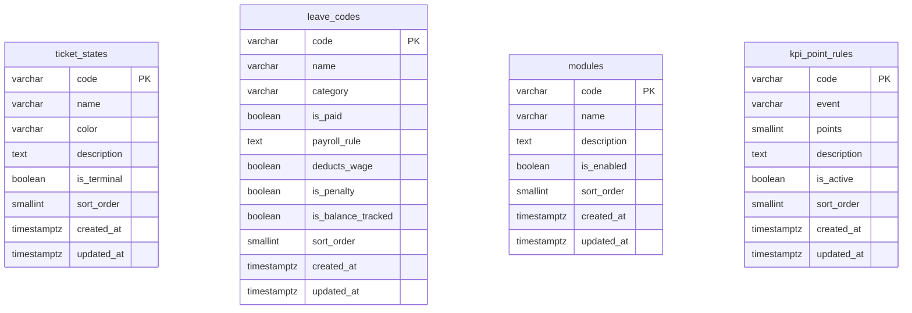
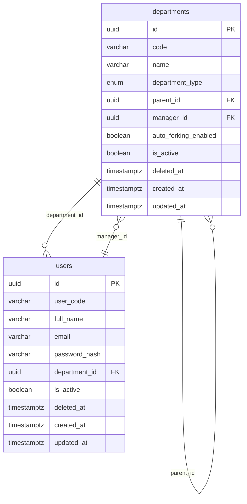
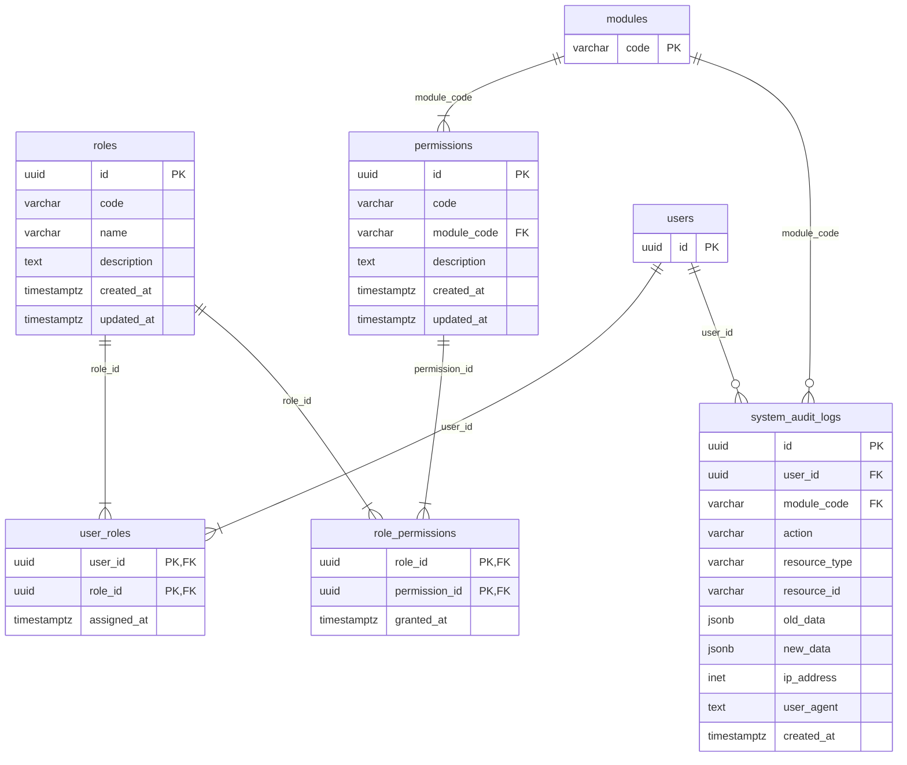
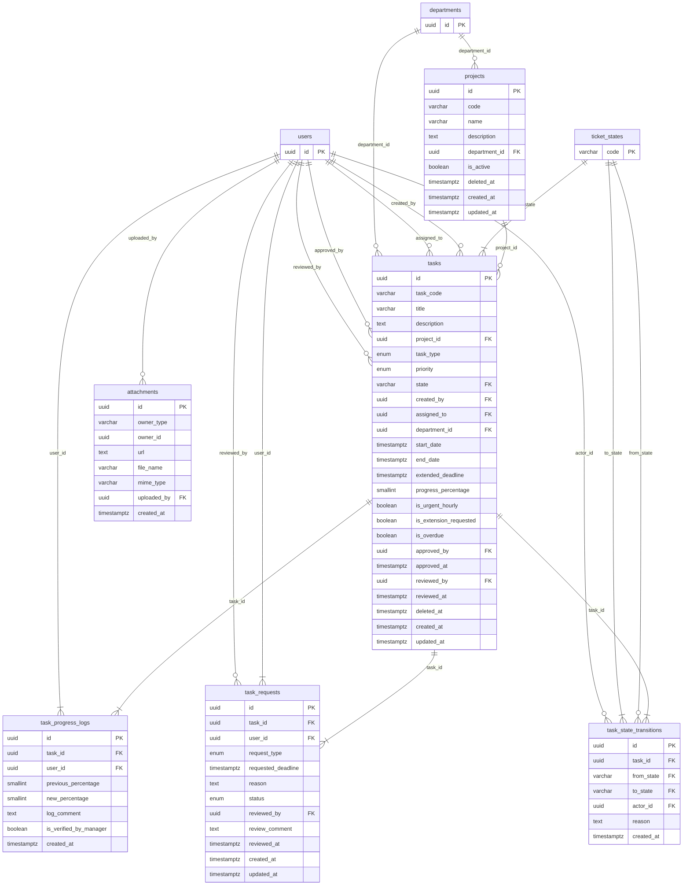
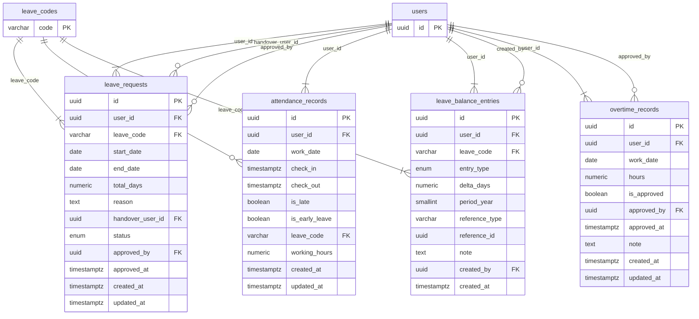
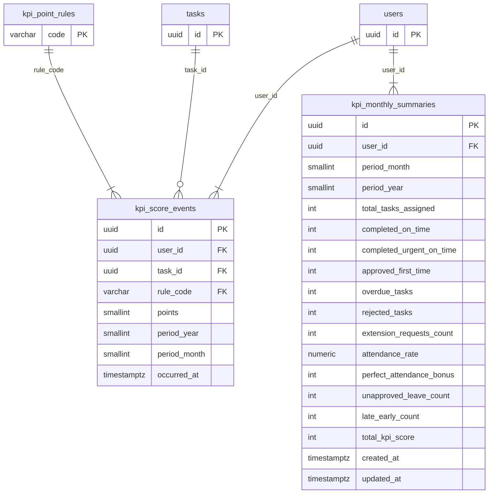
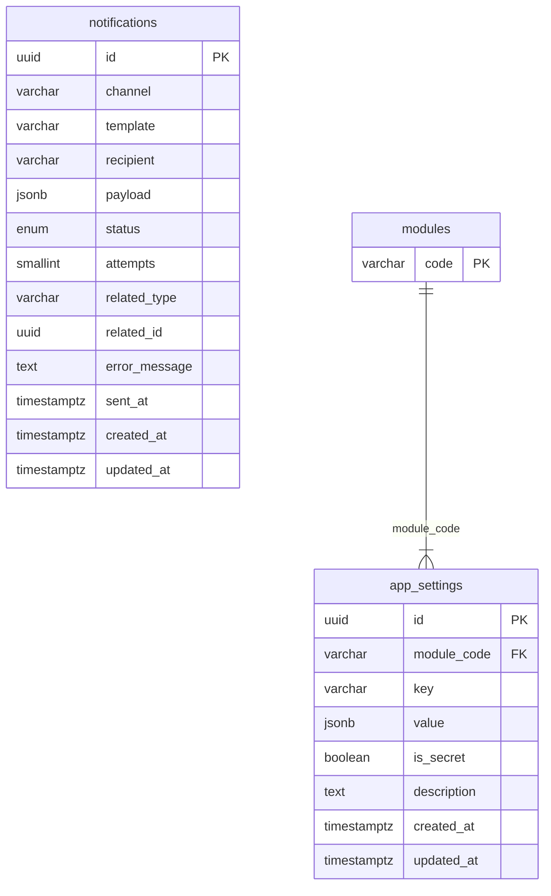
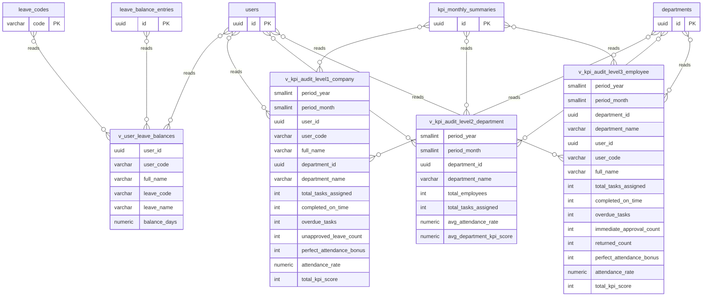

# DATABASE_SCHEMA_EXAMPLE_OPTIMIZED_DIAGRAM.md

> ER-diagram view of [`DATABASE_SCHEMA_EXAMPLE_OPTIMIZED.sql`](./DATABASE_SCHEMA_EXAMPLE_OPTIMIZED.sql). Every diagram is **Mermaid `erDiagram`** and renders in Markdown viewers (e.g. GitHub).
>
> **Legend.** Each entity is a table; each attribute is a column with a single-token type (the first word of the SQL type). `PK` marks a primary key, `FK` a foreign key. Composite keys mark each key column `PK`. Relationship lines read `PARENT ||--o{ CHILD : "fk_column"`: `||` = exactly one parent, `o{` = zero-or-many children, `|{` = one-or-many children (a `NOT NULL` foreign key). Entities prefixed **`v_`** are **read-only views, not tables**; edges labelled `reads` point from a source table to a view with a non-identifying (`}o--o{`) notation. Each diagram carries a `*Source:*` line naming the SQL it derives from. Names match the DDL exactly.

**Diagram index**

1. [Full ER Diagram](#1-full-er-diagram)
2. [Code Registries](#2-code-registries)
3. [Organization & Identity](#3-organization--identity)
4. [RBAC & Audit](#4-rbac--audit)
5. [Jobs & Projects](#5-jobs--projects)
6. [Planning, Attendance & Leave Funds](#6-planning-attendance--leave-funds)
7. [Performance & KPI](#7-performance--kpi)
8. [Platform Settings & Notifications](#8-platform-settings--notifications)
9. [Database Views](#9-database-views)

---

## 1. Full ER Diagram

All 25 tables and the four views of the optimized schema.

```mermaid
erDiagram
    ticket_states {
        varchar code PK
        varchar name
        varchar color
        text description
        boolean is_terminal
        smallint sort_order
        timestamptz created_at
        timestamptz updated_at
    }

    leave_codes {
        varchar code PK
        varchar name
        varchar category
        boolean is_paid
        text payroll_rule
        boolean deducts_wage
        boolean is_penalty
        boolean is_balance_tracked
        smallint sort_order
        timestamptz created_at
        timestamptz updated_at
    }

    modules {
        varchar code PK
        varchar name
        text description
        boolean is_enabled
        smallint sort_order
        timestamptz created_at
        timestamptz updated_at
    }

    departments {
        uuid id PK
        varchar code
        varchar name
        enum department_type
        uuid parent_id FK
        uuid manager_id FK
        boolean auto_forking_enabled
        boolean is_active
        timestamptz deleted_at
        timestamptz created_at
        timestamptz updated_at
    }

    users {
        uuid id PK
        varchar user_code
        varchar full_name
        varchar email
        varchar password_hash
        uuid department_id FK
        boolean is_active
        timestamptz deleted_at
        timestamptz created_at
        timestamptz updated_at
    }

    roles {
        uuid id PK
        varchar code
        varchar name
        text description
        timestamptz created_at
        timestamptz updated_at
    }

    permissions {
        uuid id PK
        varchar code
        varchar module_code FK
        text description
        timestamptz created_at
        timestamptz updated_at
    }

    user_roles {
        uuid user_id PK, FK
        uuid role_id PK, FK
        timestamptz assigned_at
    }

    role_permissions {
        uuid role_id PK, FK
        uuid permission_id PK, FK
        timestamptz granted_at
    }

    system_audit_logs {
        uuid id PK
        uuid user_id FK
        varchar module_code FK
        varchar action
        varchar resource_type
        varchar resource_id
        jsonb old_data
        jsonb new_data
        inet ip_address
        text user_agent
        timestamptz created_at
    }

    projects {
        uuid id PK
        varchar code
        varchar name
        text description
        uuid department_id FK
        boolean is_active
        timestamptz deleted_at
        timestamptz created_at
        timestamptz updated_at
    }

    tasks {
        uuid id PK
        varchar task_code
        varchar title
        text description
        uuid project_id FK
        enum task_type
        enum priority
        varchar state FK
        uuid created_by FK
        uuid assigned_to FK
        uuid department_id FK
        timestamptz start_date
        timestamptz end_date
        timestamptz extended_deadline
        smallint progress_percentage
        boolean is_urgent_hourly
        boolean is_extension_requested
        boolean is_overdue
        uuid approved_by FK
        timestamptz approved_at
        uuid reviewed_by FK
        timestamptz reviewed_at
        timestamptz deleted_at
        timestamptz created_at
        timestamptz updated_at
    }

    task_state_transitions {
        uuid id PK
        uuid task_id FK
        varchar from_state FK
        varchar to_state FK
        uuid actor_id FK
        text reason
        timestamptz created_at
    }

    task_progress_logs {
        uuid id PK
        uuid task_id FK
        uuid user_id FK
        smallint previous_percentage
        smallint new_percentage
        text log_comment
        boolean is_verified_by_manager
        timestamptz created_at
    }

    task_requests {
        uuid id PK
        uuid task_id FK
        uuid user_id FK
        enum request_type
        timestamptz requested_deadline
        text reason
        enum status
        uuid reviewed_by FK
        text review_comment
        timestamptz reviewed_at
        timestamptz created_at
        timestamptz updated_at
    }

    attachments {
        uuid id PK
        varchar owner_type
        uuid owner_id
        text url
        varchar file_name
        varchar mime_type
        uuid uploaded_by FK
        timestamptz created_at
    }

    leave_requests {
        uuid id PK
        uuid user_id FK
        varchar leave_code FK
        date start_date
        date end_date
        numeric total_days
        text reason
        uuid handover_user_id FK
        enum status
        uuid approved_by FK
        timestamptz approved_at
        timestamptz created_at
        timestamptz updated_at
    }

    attendance_records {
        uuid id PK
        uuid user_id FK
        date work_date
        timestamptz check_in
        timestamptz check_out
        boolean is_late
        boolean is_early_leave
        varchar leave_code FK
        numeric working_hours
        timestamptz created_at
        timestamptz updated_at
    }

    leave_balance_entries {
        uuid id PK
        uuid user_id FK
        varchar leave_code FK
        enum entry_type
        numeric delta_days
        smallint period_year
        varchar reference_type
        uuid reference_id
        text note
        uuid created_by FK
        timestamptz created_at
    }

    overtime_records {
        uuid id PK
        uuid user_id FK
        date work_date
        numeric hours
        boolean is_approved
        uuid approved_by FK
        timestamptz approved_at
        text note
        timestamptz created_at
        timestamptz updated_at
    }

    kpi_point_rules {
        varchar code PK
        varchar event
        smallint points
        text description
        boolean is_active
        smallint sort_order
        timestamptz created_at
        timestamptz updated_at
    }

    kpi_score_events {
        uuid id PK
        uuid user_id FK
        uuid task_id FK
        varchar rule_code FK
        smallint points
        smallint period_year
        smallint period_month
        timestamptz occurred_at
    }

    kpi_monthly_summaries {
        uuid id PK
        uuid user_id FK
        smallint period_month
        smallint period_year
        int total_tasks_assigned
        int completed_on_time
        int completed_urgent_on_time
        int approved_first_time
        int overdue_tasks
        int rejected_tasks
        int extension_requests_count
        numeric attendance_rate
        int perfect_attendance_bonus
        int unapproved_leave_count
        int late_early_count
        int total_kpi_score
        timestamptz created_at
        timestamptz updated_at
    }

    app_settings {
        uuid id PK
        varchar module_code FK
        varchar key
        jsonb value
        boolean is_secret
        text description
        timestamptz created_at
        timestamptz updated_at
    }

    notifications {
        uuid id PK
        varchar channel
        varchar template
        varchar recipient
        jsonb payload
        enum status
        smallint attempts
        varchar related_type
        uuid related_id
        text error_message
        timestamptz sent_at
        timestamptz created_at
        timestamptz updated_at
    }

    v_user_leave_balances {
        uuid user_id
        varchar user_code
        varchar full_name
        varchar leave_code
        varchar leave_name
        numeric balance_days
    }

    v_kpi_audit_level1_company {
        smallint period_year
        smallint period_month
        uuid user_id
        varchar user_code
        varchar full_name
        uuid department_id
        varchar department_name
        int total_tasks_assigned
        int completed_on_time
        int overdue_tasks
        int unapproved_leave_count
        int perfect_attendance_bonus
        numeric attendance_rate
        int total_kpi_score
    }

    v_kpi_audit_level2_department {
        smallint period_year
        smallint period_month
        uuid department_id
        varchar department_name
        int total_employees
        int total_tasks_assigned
        numeric avg_attendance_rate
        numeric avg_department_kpi_score
    }

    v_kpi_audit_level3_employee {
        smallint period_year
        smallint period_month
        uuid department_id
        varchar department_name
        uuid user_id
        varchar user_code
        varchar full_name
        int total_tasks_assigned
        int completed_on_time
        int overdue_tasks
        int immediate_approval_count
        int returned_count
        int perfect_attendance_bonus
        numeric attendance_rate
        int total_kpi_score
    }

    departments ||--o{ departments : "parent_id"
    users ||--o{ departments : "manager_id"
    departments ||--o{ users : "department_id"

    modules ||--|{ permissions : "module_code"
    modules ||--o{ system_audit_logs : "module_code"
    users ||--|{ user_roles : "user_id"
    roles ||--|{ user_roles : "role_id"
    roles ||--|{ role_permissions : "role_id"
    permissions ||--|{ role_permissions : "permission_id"
    users ||--o{ system_audit_logs : "user_id"

    departments ||--o{ projects : "department_id"
    projects ||--o{ tasks : "project_id"
    ticket_states ||--|{ tasks : "state"
    users ||--o{ tasks : "created_by"
    users ||--o{ tasks : "assigned_to"
    departments ||--o{ tasks : "department_id"
    users ||--o{ tasks : "approved_by"
    users ||--o{ tasks : "reviewed_by"
    tasks ||--|{ task_state_transitions : "task_id"
    ticket_states ||--o{ task_state_transitions : "from_state"
    ticket_states ||--|{ task_state_transitions : "to_state"
    users ||--o{ task_state_transitions : "actor_id"
    tasks ||--|{ task_progress_logs : "task_id"
    users ||--|{ task_progress_logs : "user_id"
    tasks ||--|{ task_requests : "task_id"
    users ||--|{ task_requests : "user_id"
    users ||--o{ task_requests : "reviewed_by"
    users ||--o{ attachments : "uploaded_by"

    users ||--|{ leave_requests : "user_id"
    leave_codes ||--|{ leave_requests : "leave_code"
    users ||--o{ leave_requests : "handover_user_id"
    users ||--o{ leave_requests : "approved_by"
    users ||--|{ attendance_records : "user_id"
    leave_codes ||--o{ attendance_records : "leave_code"
    users ||--|{ leave_balance_entries : "user_id"
    leave_codes ||--|{ leave_balance_entries : "leave_code"
    users ||--o{ leave_balance_entries : "created_by"
    users ||--|{ overtime_records : "user_id"
    users ||--o{ overtime_records : "approved_by"

    users ||--|{ kpi_score_events : "user_id"
    tasks ||--o{ kpi_score_events : "task_id"
    kpi_point_rules ||--|{ kpi_score_events : "rule_code"
    users ||--|{ kpi_monthly_summaries : "user_id"

    modules ||--|{ app_settings : "module_code"

    users }o--o{ v_user_leave_balances : "reads"
    leave_codes }o--o{ v_user_leave_balances : "reads"
    leave_balance_entries }o--o{ v_user_leave_balances : "reads"
    kpi_monthly_summaries }o--o{ v_kpi_audit_level1_company : "reads"
    users }o--o{ v_kpi_audit_level1_company : "reads"
    departments }o--o{ v_kpi_audit_level1_company : "reads"
    kpi_monthly_summaries }o--o{ v_kpi_audit_level2_department : "reads"
    users }o--o{ v_kpi_audit_level2_department : "reads"
    departments }o--o{ v_kpi_audit_level2_department : "reads"
    kpi_monthly_summaries }o--o{ v_kpi_audit_level3_employee : "reads"
    users }o--o{ v_kpi_audit_level3_employee : "reads"
    departments }o--o{ v_kpi_audit_level3_employee : "reads"
```

*Source:* `DATABASE_SCHEMA_EXAMPLE_OPTIMIZED.sql` — all table sections plus the four views.

---

## 2. Code Registries

The shared, system-wide code/catalog tables.

*Source:* `DATABASE_SCHEMA_EXAMPLE_OPTIMIZED.sql` — sections 3 (Global code registries), 4 (Modules registry), and 9 (KPI point rules). These registries have no foreign keys among themselves; they are referenced by the jobs, planning, performance, and platform tables.

---

## 3. Organization & Identity

Departments (with hierarchy) and users.

*Source:* `DATABASE_SCHEMA_EXAMPLE_OPTIMIZED.sql` — section 5 (Organization & identity).

---

## 4. RBAC & Audit

Roles, permissions, their join tables, and the system audit log.

*Source:* `DATABASE_SCHEMA_EXAMPLE_OPTIMIZED.sql` — section 6 (RBAC & system audit). `modules` and `users` are shown as key-only cross-domain entities.

---

## 5. Jobs & Projects

Projects, tickets, the state-transition history, progress logs, requests, and attachments.

*Source:* `DATABASE_SCHEMA_EXAMPLE_OPTIMIZED.sql` — section 7 (Jobs & Projects). Cross-domain parents (`users`, `departments`, `ticket_states`) are shown as key-only entities. `attachments.owner_id` is a polymorphic reference, so it draws no fixed relationship line.

---

## 6. Planning, Attendance & Leave Funds

Leave requests, attendance, the AL/TOIL balance ledger, and overtime records.

*Source:* `DATABASE_SCHEMA_EXAMPLE_OPTIMIZED.sql` — section 8 (Planning, attendance & leave funds). `users` and `leave_codes` are shown as key-only cross-domain entities.

---

## 7. Performance & KPI

The KPI score-event ledger and the per-user/month summary snapshot.

*Source:* `DATABASE_SCHEMA_EXAMPLE_OPTIMIZED.sql` — section 9 (Performance & KPI). `users`, `tasks`, and `kpi_point_rules` are shown as key-only cross-domain entities.

---

## 8. Platform Settings & Notifications

Per-module configuration and the outbound notification log.

*Source:* `DATABASE_SCHEMA_EXAMPLE_OPTIMIZED.sql` — section 10 (Platform settings & notifications). `modules` is shown as a key-only cross-domain entity.

---

## 9. Database Views

The four views are read-only and derived from base tables. In the full diagram they appear as `v_`-prefixed entities; edges labelled `reads` point from a source table to the view.

| View | Purpose | Source tables |
| --- | --- | --- |
| `v_user_leave_balances` | Current AL/TOIL (balance-tracked) leave balance per user | `users`, `leave_codes`, `leave_balance_entries` |
| `v_kpi_audit_level1_company` | KPI audit Level 1 — general, company-wide, per employee | `kpi_monthly_summaries`, `users`, `departments` |
| `v_kpi_audit_level2_department` | KPI audit Level 2 — aggregated by department / division | `kpi_monthly_summaries`, `users`, `departments` |
| `v_kpi_audit_level3_employee` | KPI audit Level 3 — per employee within a department | `kpi_monthly_summaries`, `users`, `departments` |

*Source:* `DATABASE_SCHEMA_EXAMPLE_OPTIMIZED.sql` — section 11 (Views).

---

*This document is a visual summary only; `DATABASE_SCHEMA_EXAMPLE_OPTIMIZED.sql` is authoritative for detail.*
