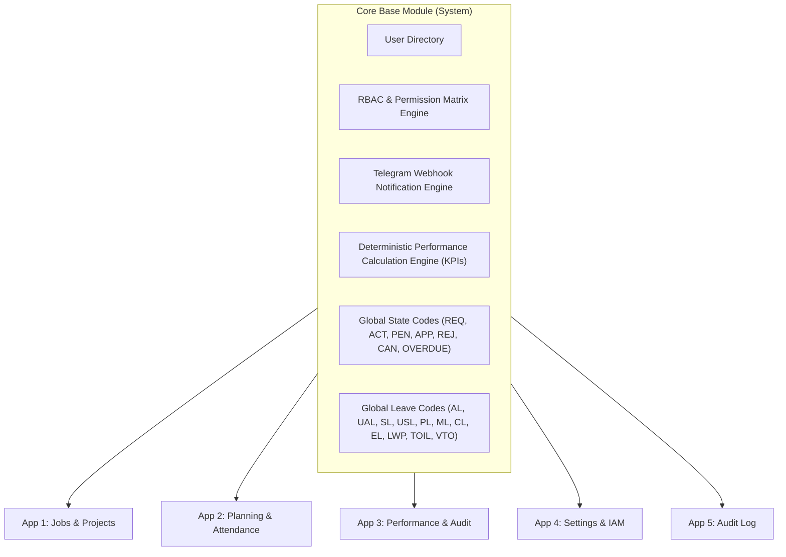
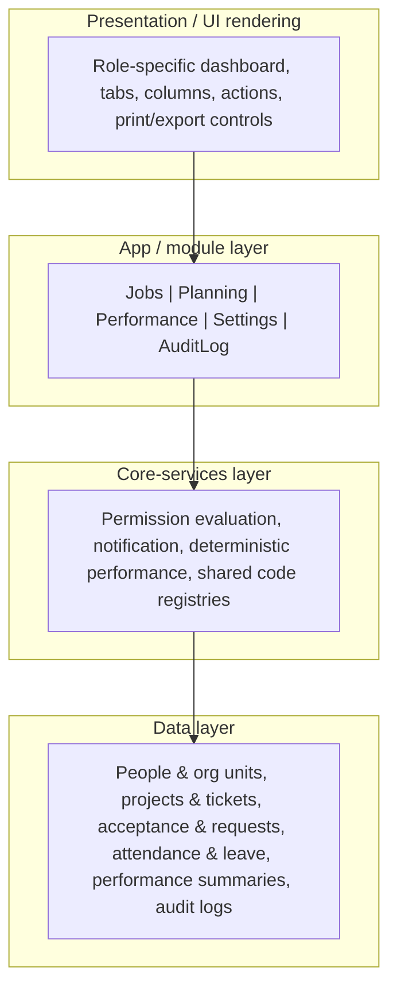
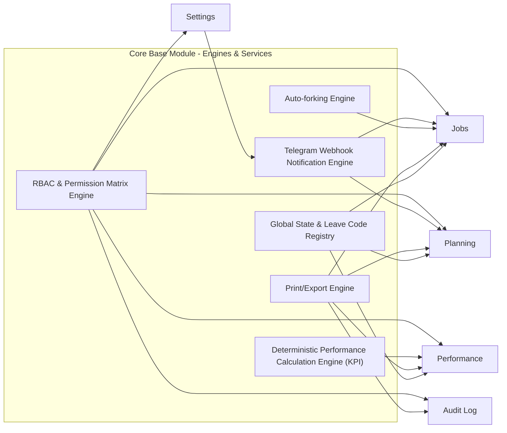
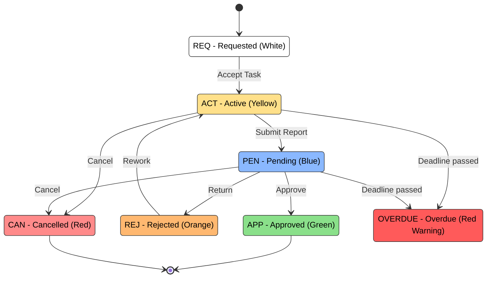
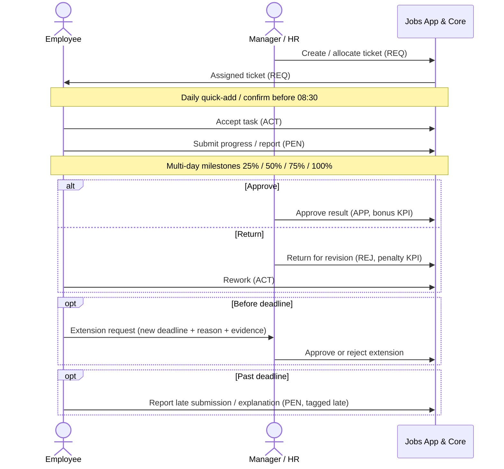
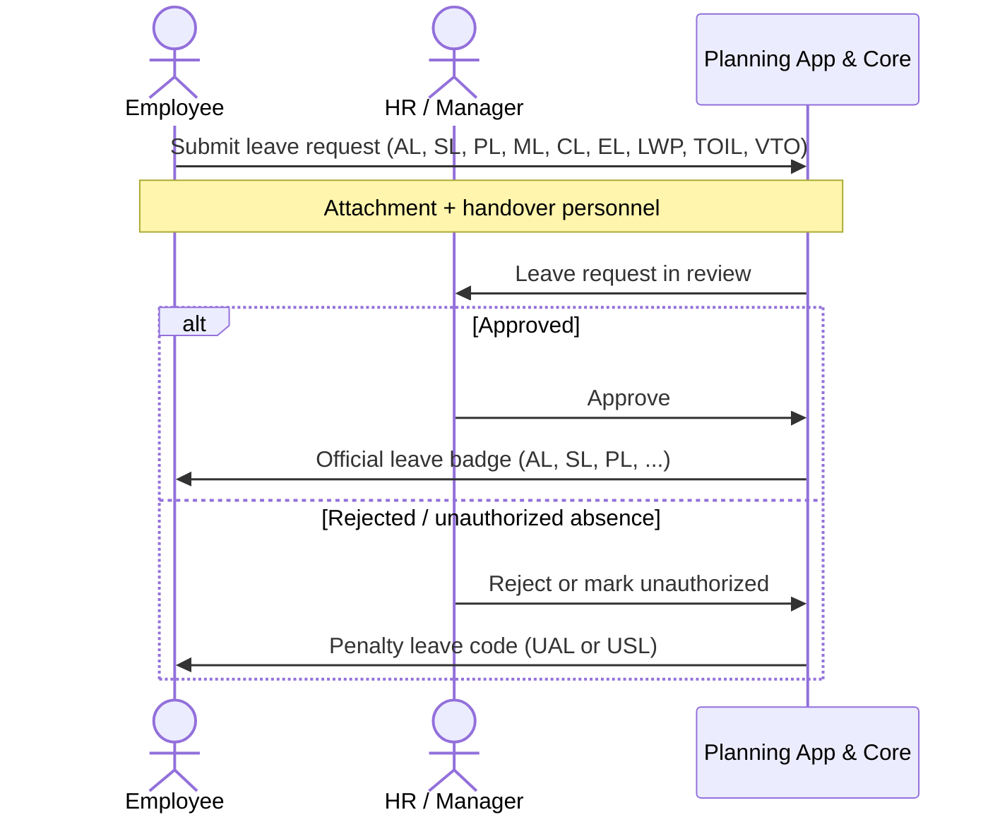
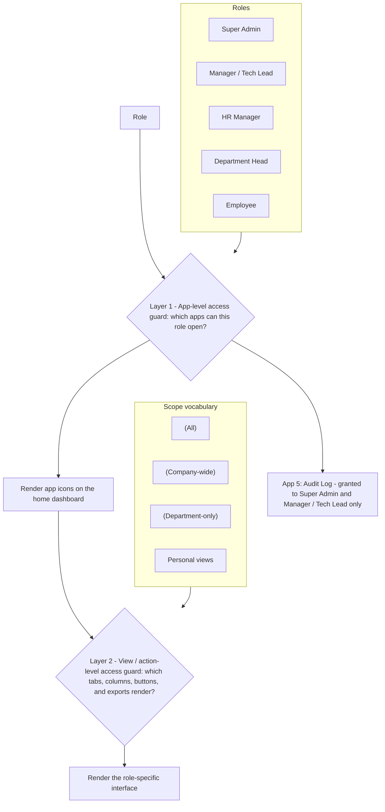
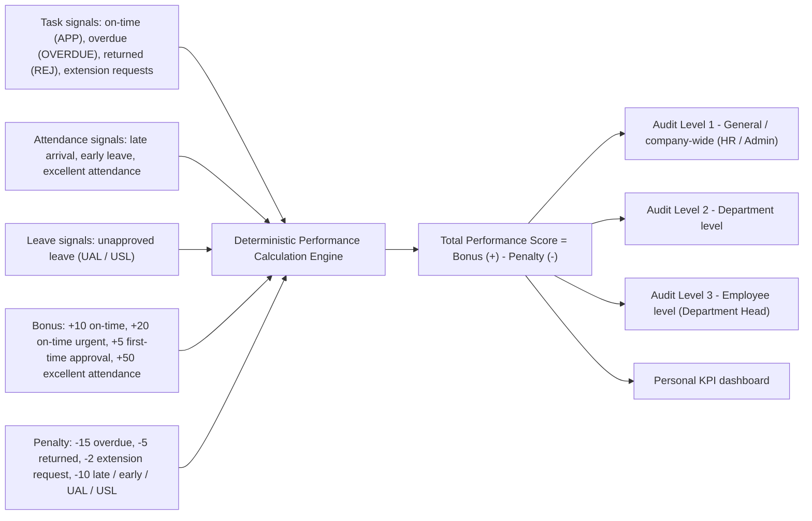
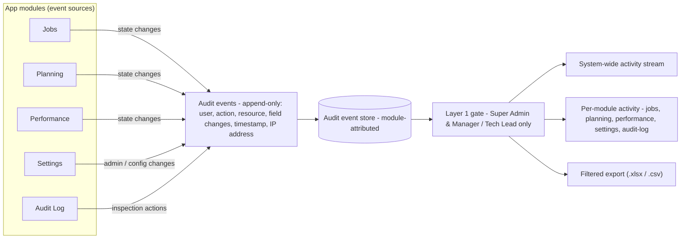
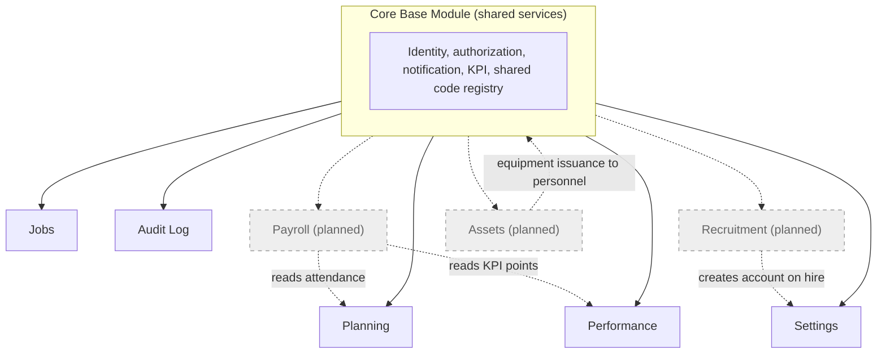

# SYSTEM_ARCHITECTURE_DIAGRAM.md

> Visual companion to [`SYSTEM_ARCHITECTURE.md`](./SYSTEM_ARCHITECTURE.md). Every diagram below is **Mermaid** (renders in Markdown viewers such as GitHub) and is derived from two documents: [`SYSTEM_ARCHITECTURE.md`](./SYSTEM_ARCHITECTURE.md) for **structure** (modules, layers, engines, authorization, extension model) and [`SYSTEM_PROCESS_FLOW-en.md`](./SYSTEM_PROCESS_FLOW-en.md) for **behavior** (state transitions, per-app flows, role-based screens).
>
> **How to read these diagrams.** Each view has a title, a one-line caption, the Mermaid block, and a `*Source:*` line pointing at the source section(s) it visualizes. The diagrams are a visual summary only — the source documents are authoritative for detail. The diagrams are deliberately technology-neutral (no frameworks, hosting, or infrastructure).

**Diagram index**

1. [System & Module Map](#1-system--module-map)
2. [Layered View](#2-layered-view)
3. [Core Engines & Services](#3-core-engines--services)
4. [Ticket State Machine](#4-ticket-state-machine)
5. [End-to-End Task Lifecycle](#5-end-to-end-task-lifecycle)
6. [Leave-Request Workflow](#6-leave-request-workflow)
7. [Authorization / RBAC Decision Flow](#7-authorization--rbac-decision-flow)
8. [KPI & Audit Data Flow](#8-kpi--audit-data-flow)
9. [Audit Log Data Flow](#9-audit-log-data-flow)
10. [Extensibility Roadmap](#10-extensibility-roadmap)

---

## 1. System & Module Map

The Core Base Module provides shared platform services; the five apps plug into it.

*Source:* `SYSTEM_ARCHITECTURE.md` §2 (System Overview & Context) and §4 (Logical Architecture); `SYSTEM_PROCESS_FLOW-en.md` — the `CORE BASE MODULE` diagram.

---

## 2. Layered View

The same system as stacked layers, from what the user sees down to what is stored.

*Source:* `SYSTEM_ARCHITECTURE.md` §5 (Layered View), synthesized from §4 and the four app sections.

---

## 3. Core Engines & Services

The six shared services of the Core Base Module and the apps that consume them.

*Source:* `SYSTEM_ARCHITECTURE.md` §9 (Core Engines & Services) and §4 (core contents); `SYSTEM_PROCESS_FLOW-en.md` — `CORE BASE MODULE` contents and per-app Print/Export Engine.

---

## 4. Ticket State Machine

The ticket lifecycle: `REQ → ACT → PEN → {APP | REJ}`, plus cancellation and overdue.

*Source:* `SYSTEM_ARCHITECTURE.md` §7.1–§7.2 (Shared Domain Model); `SYSTEM_PROCESS_FLOW-en.md` — Ticket State Codes & Color Codes and the App 1 state-transition flow.

---

## 5. End-to-End Task Lifecycle

Assignment through acceptance, including the extension-request and late-submission paths.

*Source:* `SYSTEM_ARCHITECTURE.md` §6.1 (Jobs) and §10 (timekeeping constraints); `SYSTEM_PROCESS_FLOW-en.md` — App 1 (Jobs & Projects) operational flow.

---

## 6. Leave-Request Workflow

Submitting, reviewing, and resolving a leave request, including the penalty path.

*Source:* `SYSTEM_ARCHITECTURE.md` §6.2 (Planning) and §10 (attendance rules); `SYSTEM_PROCESS_FLOW-en.md` — App 2 (Planning & Attendance) leave management workflow.

---

## 7. Authorization / RBAC Decision Flow

The two-layer guard: which apps a role may open, then which views and actions render.

*Source:* `SYSTEM_ARCHITECTURE.md` §3 (Architectural Principles) and §8 (Authorization Architecture); `SYSTEM_PROCESS_FLOW-en.md` — RBAC & UI Rendering Mechanism and the Detailed Access Control Matrix.

---

## 8. KPI & Audit Data Flow

How task, attendance, and leave signals feed the deterministic KPI engine and the audit levels.

*Source:* `SYSTEM_ARCHITECTURE.md` §6.3 (Performance) and §9.3 (Deterministic Performance Calculation Engine); `SYSTEM_PROCESS_FLOW-en.md` — App 3 (Performance & Audit) scoring algorithm and audit tables.

---

## 9. Audit Log Data Flow

How every app module's state-changing and administrative actions feed the shared, module-attributed audit store that the Audit Log app inspects.

*Source:* `SYSTEM_ARCHITECTURE.md` §6.5 (Audit Log), §2 and §10 (auditability); `SYSTEM_PROCESS_FLOW-en.md` — App 5 (Audit Log).

---

## 10. Extensibility Roadmap

Planned apps (dashed) plug into the existing core and reuse other apps' data.

*Source:* `SYSTEM_ARCHITECTURE.md` §12 (Extensibility & Future Modules); `SYSTEM_PROCESS_FLOW-en.md` — Future Module Expansion.

---

*Dashed nodes in Diagram 10 denote planned (not yet present) modules. All other diagrams depict the current architecture.*
